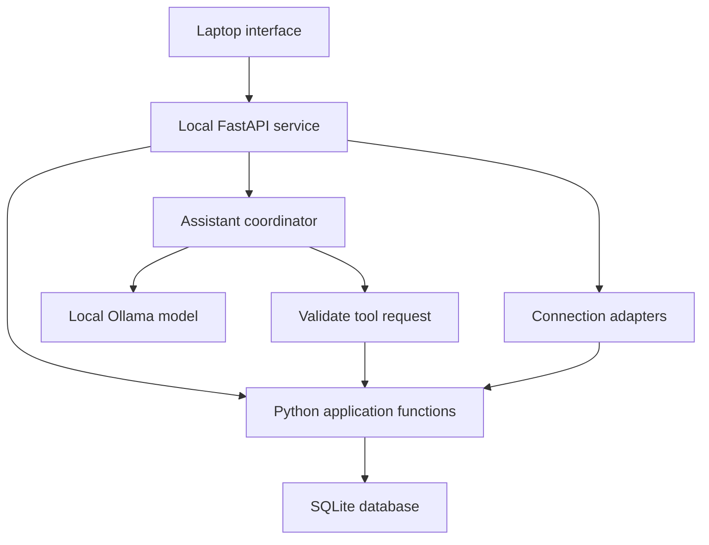

# BearPlans — Local Laptop Build Plan

Prepared October 13, 2026. Scope: a personal Mac laptop application with local storage, local Python execution, and local AI. This is an implementation plan, not a completed application. Effort estimates are planning ranges, not deadlines.

## 1. Delivery strategy

Deliver three independently useful releases:

1. **Core beta:** weekly planning, task-linked countdowns, session recovery, trees, coins, daily streaks, statistics, and backup/restore. Works offline without AI or external accounts.
2. **Assistant beta:** local model with bounded Python tool calls for plans, statistics, task changes, and timers. The core remains usable when inference fails.
3. **Connected beta:** Google Calendar, then Canvas and Gmail when authorization is available. Account connections fetch remote data; storage and processing stay on the laptop.

Do not make core delivery depend on provider approval. Defer AWS, public registration, mobile clients, cross-device sync, payments, hosted API keys, a generic plugin marketplace, and a packaged desktop wrapper. Use one repository and one Python service. Dependencies are installed once; normal core operation is offline. Model installation also requires an initial download.

## 2. Requirements and proposed rules

Confirmed: BearPlans name; laptop first; local data and execution; reference-style weekly board and projects; separate Track screen; tracking accessible from tasks and direct navigation; countdown; maximum three active hours per session; growing trees; coins for buying tree species; daily streak needs at least one hour; statistics; local AI; Canvas and Google connections; no distraction blocking and no animated character.

Defaults proposed for implementation:

- A qualifying day accumulates 60 active minutes across saved sessions. Pauses are excluded. Display progress before the threshold. Sessions spanning midnight are divided using the user's configured IANA timezone.
- One active or paused session is allowed. Starting another requires finishing the first; the backend enforces this across browser tabs.
- Countdown length is 1–180 minutes. Pauses do not consume countdown time. Three hours is a session cap, not a daily cap or an operating-system guarantee.
- Finishing a session does not complete its task automatically. The interface offers that as a separate action.
- One free tree species, three additional purchasable species, and three growth stages are sufficient for the beta. Species are cosmetic. Completing the countdown plants a mature tree. Ending early records work and an unfinished tree.
- Initial reward rate: one coin per whole active minute, calculated once from the session total. This and tree prices are configurable product defaults, not previously confirmed requirements. No penalty for pauses or a missed day.
- Correcting a session recalculates its reward contribution through an adjustment ledger; an already finalized session cannot award twice. If a correction makes the balance negative after coins have been spent, retain purchases, show the adjustment, and disable new purchases until the balance recovers.
- Day assignment is separate from a due date. Moving planned work does not change the actual deadline. Closing a week snapshots its plan; unfinished tasks can be placed in the next week without losing their identity or time history.

## 3. User interface

Navigation: **Plan, Track, Stats, Weeks**, with Assistant and Settings/Connections buttons. The forest and tree shop are part of Track rather than another top-level application.

Landscape: project/task list beside the weekly board. Preserve Today, week selection, Assign Days, Move Work, End Week, and completion counts. On narrower laptop windows, show the selected day's list and collapsible projects. Favor readable cards over seven squeezed columns.

Task detail: title, project, subtasks, due date/time, planned date, estimate, notes, completion, tracked time, and source link when imported. Support quick task creation and keyboard navigation before adding drag-and-drop polish. Date assignment buttons are a simpler first implementation than complex drag interactions.

Track: chosen task, remaining time, growth stage, species selector, and Start/Pause/Resume/Finish. Keep a compact active timer available while navigating. Select a task from this screen even when it has no planned date.

Stats: completion counts and percentages; tracked minutes per day/project/task; estimated versus actual time; daily streak progress; session correction. Count planned work items consistently: a parent task's subtasks must not also count as duplicate parent completions. Track explicit leaf-level work items for the initial planner.

Assistant: contextual panel with selected task/day/week, source references, and change previews. Changes have Undo. A disconnected or loading model never disables manual task/timer controls.

## 4. Architecture

Recommended components:

- React + TypeScript with Vite for the interface. Production builds are static files served by FastAPI from the same origin. The development server can be separate during coding.
- Python + FastAPI + Pydantic for HTTP interfaces, typed inputs, and application functions. One Uvicorn worker for the personal app.
- SQLite on the local disk, foreign keys enabled, versioned SQL migrations, short transactions, WAL mode, and a serialized application write path. SQLite permits only one writer at a time; WAL allows readers to proceed alongside a writer.
- Ollama runs separately. Access it asynchronously so inference does not hold database transactions or block timer requests. Keep cloud features disabled for this release.
- pytest for service/rule tests; a small set of browser end-to-end tests for important user journeys. Use a fake clock for deterministic timer tests.

Avoid independent database writes from AI, synchronization jobs, and UI routes. All mutations use the same application functions and transaction rules. A write lock is scoped only to database work; never keep it held while waiting for AI or a provider API.

Suggested repository boundaries: frontend; backend/routes; backend/domain; backend/storage; backend/ai; backend/integrations; backend/platform; tests; docs. These are directories in one project, not separate services.

## 5. Data model

| Record | Purpose |
| --- | --- |
| Project | Groups tasks and carries display metadata. |
| Task | Stable identity, project, parent task, title, notes, deadline, estimate, completion and revision. |
| Week / planned item | Assignment of a task or subtask to a date, ordering, and closed-week snapshot. |
| Session | Task, selected duration, species, lifecycle state, credited seconds, revision and recovery status. |
| Session segment | Start/end of each active interval; supports pauses, midnight allocation and corrections. |
| Tree species / planted tree | Prices and species ownership; a planted tree references its completed session. |
| Coin ledger | Earn, spend and adjustment entries. Unique session-award/purchase operation IDs prevent duplicates. |
| Settings | Timezone, defaults, model selection and retention preferences. |
| Chat / tool action | Messages and minimal action history for troubleshooting and Undo. |
| Connection / source item | Added later: account metadata, external IDs, last-sync markers and import suggestions. Tokens are stored separately in Keychain. |

Derive streaks and statistics from session segments rather than maintaining an unrelated mutable streak counter. Snapshot comparison denominators when closing a week. Store actual instants in UTC; date-only deadlines stay date-only. Preserve original source timezone information.

## 6. Timer correctness and Mac sleep

Persist changes on start, pause, resume and finish. Use monotonic elapsed time for an uninterrupted running interval; keep persisted wall-clock timestamps and periodic checkpoints for recovery. Validate clock changes and never automatically credit uncertain intervals.

While the service and laptop are awake, closing or minimizing the browser does not end the session. The local service monitors expiry and finalizes the session once. Browsers may throttle their display refresh, so JavaScript tick counts are not authoritative.

Prove Mac sleep handling early: a small native power-event adapter should pause the session on sleep and leave it paused after wake. Verify against the actual Mac, including lid closure. A browser visibility event does not distinguish sleep from switching tabs.

Fallback if precise power events are not available: checkpoint progress, detect a processing gap after wake/restart, and place the session in **Needs review**. Show the last trusted interval and let the user reconcile it. Do not claim perfect automatic sleep exclusion or finalize uncertain coins/streak credit.

Session lifecycle: idle → running → paused → running; running/paused → finished early; running → completed; unclean interruption → needs review. Finalization, its coin award and its planted tree are one transaction. Retrying finish or opening another tab cannot repeat rewards.

Minimum tests: refresh; hidden tab; two tabs starting at once; pause/resume; expiry; early finish; three-hour boundary; sleep/wake; backend restart; clock change; midnight; daylight-saving transition; duplicated finish request.

## 7. Milestones, estimates and acceptance gates

Estimates assume one developer comfortable with Python but learning parts of the frontend. They exclude provider approval delays and require measurement after the first milestone.

| Milestone | Effort | Concrete deliverable | Acceptance gate |
| --- | --- | --- | --- |
| M0: Foundation and risky spike | 4–6 h | Scope/rules, initial schema, local launcher, timer/sleep proof, application-function boundary | Create a task through the service, restart it, and retrieve it; document actual Mac sleep behavior. |
| M1: Planner | 16–24 h | Reference-style Plan/Weeks screens, projects, tasks/subtasks, assignment, movement and completion | Plan a real week, move unfinished work, close/reopen historical views, restart without losing edits. |
| M2: Countdown and recovery | 18–28 h | Track screen, compact timer, segments, pauses, expiry, interruption recovery | Timer tests pass; two tabs cannot create two active sessions; known pauses/sleep never earn time. |
| M3: Forest and statistics | 12–18 h | Four species, basic shop, coin ledger, daily streak and reports | Two 30-minute sessions qualify; duplicated finalization cannot double coins; corrections update derived reports. |
| M4: Personal core release | 8–12 h | Single launch command, migrations, backup/restore, useful errors, seven-day trial | Use the app for seven days; restore a backup in a clean location; no unresolved data-loss, timer or reward errors. |
| M5: Local assistant | 20–35 h | Bounded tool coordinator, local model setup, contextual chat, read and action tools | Pass evaluation cases; no unauthorized tools; invalid arguments cause no mutation; core remains responsive during inference. |
| M6: Google Calendar | 12–20 h | Read-only selected calendars, local event cache and occupied-time view | Repeated sync does not duplicate events; revoked access and offline operation produce clear status. |
| M7: Canvas and Gmail | Estimate after access spike | Selected-source imports, source links, change review and duplicate prevention | Access works, uncertain dates are reviewed, local edits survive resync, tokens are protected. |

Core work totals 58–88 focused hours; reserve about 25% contingency, giving approximately **73–110 hours**. At 10 hours/week that is roughly 8–11 weeks; at 15 hours/week roughly 5–8 weeks. The seven-day trial may add calendar time. These are capacity scenarios, not commitments. M5 and M6 are additional work; M7 is deliberately uncommitted.

## 8. AI implementation and evaluation

Expose Python functions before connecting the model. UI controls and model requests call the same functions.

Start with a small tool set:

| Stage | Tools |
| --- | --- |
| Read-only | get_day_plan, get_week_plan, search_tasks, get_task, get_time_summary |
| Explicit small actions | create_task, update_task, assign_task_date, complete_task, start_timer, pause_timer, finish_timer |
| Larger proposals | propose_replan, validate_replan, apply_replan with a reviewed proposal ID |
| Imported text later | search_source_documents, get_source_excerpt, list_import_suggestions, accept_import |

Each tool has an explicit schema, bounded result size, stable IDs, expected revision for edits and a request ID for replay safety. Do not expose arbitrary SQL, Python execution, shell access or unbounded filesystem access to the assistant. Query functions compute exact totals. Full-text search starts document retrieval; add embeddings only when a measured retrieval problem justifies them.

Flow: request → relevant context → model tool selection → schema/intent validation → application function → result → response. Bound the loop initially to five tool rounds; timeout and cancellation return a useful error instead of repeating forever. Serialize mutations. A model cancellation does not undo a mutation already committed; report its outcome.

Direct requests such as “Start Math 55 for 45 minutes” may execute after valid task resolution. Ambiguous task names prompt for selection. Suggested week-wide changes require a reviewed preview. Recheck record revisions before applying an old preview. Calendar-write, email-send, deletion of connection data and reward-grant tools are not in the first assistant surface.

Select the local model by evaluating actual BearPlans requests, not parameter count. Compare two tool-capable candidates on the Mac. Record model/version, quantization, context limit, schema, prompts, latency and errors. Start with modest context and tune based on retrieval and memory measurements.

Create 30 fixed evaluation scenarios: 10 retrieval/statistics, 10 task changes/replanning, 5 timers, and 5 ambiguity or injected-source instructions. Require every exact statistic to match its Python result, zero unauthorized actions in the set, and at least 90% end-to-end success overall before using assistant writes daily. These are release gates on a limited test set, not proof of general reliability. Evaluate responsiveness under model load separately; timer controls must not wait for generation.

## 9. Connections and local privacy

Connections are separate adapters, not an open plugin system. Fetch provider data outside database transactions; normalize into source items; apply changes through application functions. Use stable IDs and unique constraints, source-versus-user ownership of fields, retries with backoff and visible last-success timestamps.

Calendar first: read selected calendars and events. Canvas next: selected course assignments and due dates when authorization is available. Gmail last: selected labels/filters with suggested actions in an inbox. Preserve source links. A due-date update cannot erase user subtasks or scheduled dates. Prompt review on conflicts and unclear extraction. An unavailable source differs from a source with no published assignment.

Use Mac Keychain for tokens. SQLite and backups contain private content and are not automatically encrypted by local storage. Use restrictive file permissions, avoid content/credential logging, document backup contents and rely on the owner's disk-encryption policy; evaluate app-level encryption only if the threat model requires it. Disconnect revokes when supported and removes stored tokens; cached-source deletion is a separate explicit choice.

Bind the local service to loopback. Validate Host and Origin, use authenticated local requests and CSRF protection where relevant, and avoid wildcard CORS. An unrelated website must not be able to call local mutation routes. Ollama stays behind the service and is not exposed to the LAN.

## 10. Local deployment, updates and recovery

Development: reproducible Python and frontend lockfiles, a fresh local test database, and no real secrets in source control. Release: build the frontend once, serve it with FastAPI, and provide a single start command that checks dependencies, applies migrations, checks for duplicate instances and opens the browser.

Store application data outside the repository/build directory, such as a BearPlans folder under the Mac's Application Support directory. Updates replace code, not user data. Ollama/model downloads are explicit; if missing, disable chat with setup guidance and leave the core available.

Backups use SQLite's supported backup API, not a naive copy of a live WAL database. Create one daily on launch when due and one before migrations. Initial retention: seven daily and four weekly copies, configurable. Exclude credentials. Offer export/import of plans and backup/restore of the full database as distinct actions. Verify a restore into a clean directory; stop writes before replacing the active database. Preserve the original if migration/restore fails.

Use redacted diagnostic logs with bounded retention. Record operation IDs, timestamps and error codes rather than email bodies or chat contents. Keep releases tagged and migrations versioned. A failed update must leave the old database and a readable error; never silently reset it.

## 11. Working rhythm and scope control

Keep one milestone active and one small ticket in progress. Tickets should normally fit one 1–3 hour session and end with a demonstration or a meaningful check. A milestone is finished only after its acceptance gate. Track new ideas in a later list and trade scope explicitly rather than inserting them into the active milestone.

Example first-week backlog:

1. Record confirmed requirements and configurable reward defaults.
2. Set up the one-repository frontend/backend and a local launcher.
3. Implement a migration and task create/read function.
4. Display saved tasks in a minimal Plan screen.
5. Spike the countdown and sleep/wake behavior on the real Mac.
6. Write timer/reward invariants as acceptance cases.

Weekly review: demonstrate completed work, compare actual effort with estimates, identify one blocker, and select the next three small tickets. Use the app on real coursework as soon as planner persistence works. Keep the first forest intentionally small. Expand decorative assets after the core trial, not before.

## 12. Release decision

Ship the core beta when you can plan your week, track an unscheduled task, recover an interruption, earn coins once, buy a tree, qualify for a streak, inspect exact statistics, and restore your data. No open severe persistence or timer defects. Then add AI to an already useful app.

Source references checked for this plan:

- SQLite WAL and single-writer behavior: https://www.sqlite.org/wal.html
- SQLite supported backup workflow: https://www.sqlite.org/backup.html
- FastAPI manual local server deployment: https://fastapi.tiangolo.com/deployment/manually/
- Ollama tool calling: https://docs.ollama.com/capabilities/tool-calling
- Ollama structured outputs: https://docs.ollama.com/capabilities/structured-outputs
- Browser background throttling: https://developer.mozilla.org/en-US/docs/Web/API/Page_Visibility_API

The architecture, ticket sizes, effort ranges, release gates and reward defaults are engineering proposals. Exact Mac sleep handling requires the M0 hardware test; the plan does not claim that browser visibility alone implements it.
